 

# ⚡ Awesome Real-Time Contract Redlining & Collaboration 📝

> 🌟 **A comprehensive, curated directory of top Real-Time Contract Redlining, Collaborative Negotiation platforms, and Legal AI Suites** — featuring enterprise SaaS CLM tools alongside self-hosted, sovereign open-source co-editing alternatives.  
> 🌟 *Star this repository if you find it helpful for your legal engineering and legal tech stack!* 🌟

---

## 📑 Table of Contents

- [📊 Sector Overview & Market Dynamics](#-sector-overview--market-dynamics)
- [🏢 SaaS & Hosted Commercial Platforms](#-saas--hosted-commercial-platforms)
- [🔓 Open-Source & Self-Hosted Software](#-open-source--self-hosted-software)
- [🔍 Detailed Platform Profiles](#-detailed-platform-profiles)
  - [🏢 SaaS Platforms](#-saas-platforms)
  - [🔓 Open-Source Repositories](#-open-source-repositories)
- [⚖️ Feature Comparison Matrix](#️-feature-comparison-matrix)
- [💖 Support](#-support)
- [📈 Star History](#-star-history)
- [🤝 Contributing](#-contributing)
- [📜 License](#-license)

---

## 📊 Sector Overview & Market Dynamics

The global Contract Lifecycle Management (CLM) and contract collaboration market is estimated at **$1.8 billion to $3.2 billion** and is projected to expand at an **11%–14% CAGR** toward **$5 billion to $11 billion** over the next decade. The sector remains **moderately fragmented with active consolidation**, characterized by 150+ specialized point solutions for contract redlining and AI negotiation alongside leading enterprise CLM suites and big-tech productivity providers actively acquiring AI-native drafting tools.

---

## 🏢 SaaS & Hosted Commercial Platforms

The table below summarizes commercial, cloud-hosted contract redlining, editing, and CLM platforms, sorted in descending order by company scale (market capitalization, valuation, or estimated annual recurring revenue):

| 🏢 Platform | 💰 Company Scale (Valuation / Revenue) | 🏷️ Starting Tier Price | 🎁 Free Tier / Trial Limit | 🎯 Key Capabilities |
| :--- | :--- | :--- | :--- | :--- |
| **Microsoft Word for the Web (M365)** | ~$3.87 Trillion Market Cap | **$6.00 / user / month** (Microsoft 365 Business Basic, billed annually) | **Free-forever web tier**: Free with Microsoft account; includes 5 GB cloud storage and browser co-authoring | Industry standard `.docx` Track Changes, inline comments, real-time multi-user cursor editing. |
| **Google Docs (Google Workspace)** | ~$3.55 Trillion Market Cap (Alphabet) | **$6.00 / user / month** (Workspace Business Starter, billed annually) | **Free-forever tier**: Free with personal Google account; includes 15 GB shared cloud storage and Suggestion Mode | Zero-latency real-time co-authoring, Suggestion Mode (track changes), comment history & notifications. |
| **Icertis Vera Engage** | ~$5.0 Billion Valuation (~$350M ARR) | **$88,000 / year** (Median ACV; starting enterprise deployments typically ~$100,000/yr) | **No free tier or public trial**: Evaluation strictly via custom enterprise sandbox demo | Generative AI Redline Agent, AI-generated legal playbooks, automated clause risk scoring & compliance. |
| **Ironclad Editor** | ~$3.2 Billion Valuation (~$200M ARR) | **$50,000 / year** (Base mid-market deployment starting range; average ACVs $50k–$120k/yr) | **No free tier or public trial**: Guided proof-of-concept / sandbox via enterprise sales engagement | Native in-browser DOCX/PDF editing, tracked changes, counterparty redline email import, Jurist AI review. |
| **SpotDraft** | ~$200 Million Valuation (~$25M ARR) | **$1,250 / month** ($15,000 / year starting annual package for growth teams) | **No free tier or public trial**: Hands-on evaluation restricted to scheduled guided product demos | Native Microsoft Word desktop integration, VerifAI playbook redline suggestions, single/multi-party draft flows. |
| **Concord** | ~$12 Million ARR (~$47M Funding) | **$499 / month** ($5,988 / year Essentials tier billed annually for 5 users) | **14-day free trial**: Full access to contract generation, collaborative editing, and unlimited e-signatures | Live color-coded revisions, private internal-only drafting drafts vs. external published changes. |

---

## 🔓 Open-Source & Self-Hosted Software

The table below highlights open-source repositories and self-hosted tools for contract redlining, document diffing, and collaborative legal editing, sorted in descending order by GitHub stargazer count:

| 🔓 Repository / Project | ⭐ GitHub_Stars | ⚖️ License | 💻 Tech Stack | 📌 Focus Area |
| :--- | :--- | :--- | :--- | :--- |
| **[Nextcloud Server (Write / Collabora)](https://github.com/nextcloud/server)** |  | AGPL-3.0 | PHP / TypeScript | Sovereign private-cloud workspace with real-time collaborative document review mode and tracked changes. |
| **[Etherpad](https://github.com/ether/etherpad)** |  | Apache-2.0 | Node.js / JavaScript | Low-latency real-time collaborative co-editing engine with authorship timeline time-slider diffing. |
| **[CryptPad](https://github.com/cryptpad/cryptpad)** |  | AGPL-3.0 | JavaScript | End-to-end encrypted, zero-knowledge collaborative document editing suite with version tracking. |
| **[ONLYOFFICE DocumentServer](https://github.com/ONLYOFFICE/DocumentServer)** |  | AGPL-3.0 | C++ / JavaScript | Full-featured document editing engine with native MS Office `.docx` Track Changes and comment review modes. |
| **[Collabora Online](https://github.com/CollaboraOnline/online)** |  | MPL-2.0 | C++ / JavaScript / Python | Enterprise-grade LibreOffice-based web document editing engine with multi-party redlining and revision controls. |
| **[AI WorkDeck](https://github.com/AI-WorkDeck/aiworkdeck)** |  | Open Source (CLA) | Java / TypeScript / Office Add-in | Git-backed professional document workstation with 3-way contract merge workflows and source-linked citations. |
| **[evolsb/legal-redline-tools](https://github.com/evolsb/legal-redline-tools)** |  | MIT | Python / Shell | Automated CLI toolset and AI skills for generating real Track-Changes `.docx` files and side-by-side redline PDFs. |
| **[crosbylegal/redline-bench](https://github.com/crosbylegal/redline-bench)** |  | MIT | Python | Benchmark and negotiation simulator measuring multi-turn legal contract redlines and margin comments. |
| **[AniketTati/draft-legal](https://github.com/AniketTati/draft-legal)** |  | AGPL-3.0 | TypeScript / Python / Docker | Self-hosted, AI-native CLM platform (open-source alternative to Ironclad + Harvey) with automatic redline proposals. |
| **[AnsonLai/docx-redline-js](https://github.com/AnsonLai/docx-redline-js)** |  | MIT | JavaScript / Node.js | Lightweight OOXML parser and reconciler for generating native Microsoft Word redlines and markup programmatically. |

---

## 🔍 Detailed Platform Profiles

### 🏢 SaaS Platforms

#### Icertis Vera Engage
- **Type:** 🤖 Agent-driven drafting and redlining inside enterprise CLM  
- **Scale:** ~$5.0B Valuation (~$350M ARR)  
- **Pricing:** Custom enterprise quotes; median Annual Contract Value (ACV) starts around $88,000/yr (initial deployment packages $100,000–$300,000+).  
- **Free Tier / Trial:** None. Access requires an enterprise sales engagement and customized sandbox demonstration.  
- **Overview:** Icertis Vera Engage transforms contract collaboration through conversational AI agents. Its **Redline Agent** enforces enterprise guidelines, detects non-compliant clauses, and supplies alternative language. Its **AI-Generated Playbooks** digitize negotiation history into codified rules.  
- **Best for:** Large enterprise procurement and legal departments already invested in the Icertis ecosystem.

#### Ironclad Editor
- **Type:** ✍️ In-platform document editing with tracked changes and redline import  
- **Scale:** ~$3.2B Valuation (~$200M ARR)  
- **Pricing:** Starts at ~$50,000/year for mid-market setups (average enterprise contracts run $50,000–$120,000+/yr plus implementation).  
- **Free Tier / Trial:** None. Available strictly through enterprise sales consultations and managed pilot environments.  
- **Overview:** Ironclad Editor provides centralized revision tracking for DOC, DOCX, and PDF documents. Key features include **Track Changes**, **Edit from Redlines**, and **Incorporate Counterparty Changes** (which digests markup received over email). The **Contract Review Agent** allows fine-grained AI clause alterations.  
- **Best for:** In-house legal operations teams demanding tight integration between approval routing and counterparty markup.

#### SpotDraft
- **Type:** 📄 AI-assisted negotiation with native Microsoft Word integration  
- **Scale:** ~$200M Valuation (~$25M ARR)  
- **Pricing:** Starts at ~$1,250/month ($15,000/year billed annually) for growing legal teams, scaling up to $35,000–$65,000+/year for enterprise volume.  
- **Free Tier / Trial:** None. Product evaluations are conducted via customized one-on-one team demonstrations.  
- **Overview:** Built on the insight that over 90% of contract editing occurs within Word, SpotDraft provides a desktop Word plugin combined with **VerifAI** playbook guidance. Reviewers can accept suggested redlines directly inside desktop Word and sync drafts automatically back to the repository.  
- **Best for:** Legal counsels who refuse to compromise on Word formatting fidelity while requiring centralized tracking.

#### Concord
- **Type:** 🤝 Real-time collaborative redlining with internal-only revisions  
- **Scale:** ~$12M ARR (~$47M Total Funding)  
- **Pricing:** **Essentials:** $499/month (includes 5 users, billed annually); **Business:** $899/month; **Enterprise:** $1,299/month. Extra users are $49–$89/user/month.  
- **Free Tier / Trial:** 14-day full-featured free trial with unlimited e-signatures and collaborative drafting; no credit card required.  
- **Overview:** Concord facilitates real-time online redlining with color-coded cursors and revision toggling. Teams can maintain private internal-only comments and revisions before publishing a fresh version to counterparties. Includes complete audit trails and guest signer access.  
- **Best for:** Mid-market legal teams seeking cost-effective, real-time negotiation without imposing software installations on external parties.

#### Microsoft Word Online
- **Type:** 🌐 Browser-based Word with co-authoring and Track Changes  
- **Scale:** ~$3.87 Trillion Market Cap (Microsoft)  
- **Pricing:** Microsoft 365 Business Basic starts at **$6.00 / user / month** (billed annually). Business Standard is $12.50 / user / month.  
- **Free Tier / Trial:** **Free forever** via browser for any personal Microsoft account (includes 5 GB OneDrive storage). 30-day trial available for business suites.  
- **Overview:** The universal standard for legal markup. Features tracked changes, granular sidebar comments, inline revision accept/reject, and seamless transition to Word Desktop.  
- **Best for:** Any legal workflow where counterparty compatibility is paramount.

#### Google Docs
- **Type:** 👥 Real-time collaborative document editing with Suggestion Mode  
- **Scale:** ~$3.55 Trillion Market Cap (Alphabet)  
- **Pricing:** Google Workspace Business Starter starts at **$6.00 / user / month** (billed annually). Business Standard is $12.00 / user / month.  
- **Free Tier / Trial:** **Free forever** for personal accounts with 15 GB shared storage. 14-day free trial available for Google Workspace business tiers.  
- **Overview:** Offers blazing-fast real-time co-editing with presence awareness. **Suggestion Mode** functions as real-time tracked changes with instant acceptance/rejection controls.  
- **Best for:** Fast-moving teams, startups, and cross-functional teams already standardized on Google Workspace.

---

### 🔓 Open-Source Repositories

#### Nextcloud Server (Write / Collabora)
- **Repo:** [nextcloud/server](https://github.com/nextcloud/server)  
- **Stack:** PHP / TypeScript / Collabora Office | **License:** AGPL-3.0  
- **Capabilities:** Enterprise private cloud platform offering document co-editing with review mode, margin comments, granular share permissions, and complete audit history.

#### Etherpad
- **Repo:** [ether/etherpad](https://github.com/ether/etherpad)  
- **Stack:** Node.js / JavaScript | **License:** Apache-2.0  
- **Capabilities:** Highly customizable real-time collaborative text editor famous for its infinite revision history slider and multi-cursor synchronization.

#### CryptPad
- **Repo:** [cryptpad/cryptpad](https://github.com/cryptpad/cryptpad)  
- **Stack:** JavaScript | **License:** AGPL-3.0  
- **Capabilities:** Privacy-first, zero-knowledge end-to-end encrypted collaborative suite supporting rich text, Markdown, and document change tracking.

#### ONLYOFFICE DocumentServer
- **Repo:** [ONLYOFFICE/DocumentServer](https://github.com/ONLYOFFICE/DocumentServer)  
- **Stack:** C++ / JavaScript | **License:** AGPL-3.0  
- **Capabilities:** Powerful document editing server providing 100% native compatibility with Microsoft DOCX tracked changes, comments, and compare modes.

#### Collabora Online
- **Repo:** [CollaboraOnline/online](https://github.com/CollaboraOnline/online)  
- **Stack:** C++ / JavaScript / Python | **License:** MPL-2.0  
- **Capabilities:** Cloud-native LibreOffice suite that brings document redlining, revision tracking, and real-time collaboration to any cloud storage backend.

#### AI WorkDeck
- **Repo:** [AI-WorkDeck/aiworkdeck](https://github.com/AI-WorkDeck/aiworkdeck)  
- **Stack:** Java / TypeScript / Office Add-in | **License:** Open Source (with CLA)  
- **Capabilities:** Git-backed legal AI desktop workspace featuring 3-way contract diffing, clause extraction, and verification against original documents.

#### evolsb/legal-redline-tools
- **Repo:** [evolsb/legal-redline-tools](https://github.com/evolsb/legal-redline-tools)  
- **Stack:** Python / Shell | **License:** MIT  
- **Capabilities:** Generates genuine Track-Changes Word documents and side-by-side redline PDFs from AI-generated contract reviews.

#### crosbylegal/redline-bench
- **Repo:** [crosbylegal/redline-bench](https://github.com/crosbylegal/redline-bench)  
- **Stack:** Python | **License:** MIT  
- **Capabilities:** Rigorous evaluation suite and benchmark that evaluates LLMs and legal AI agents on realistic multi-turn contract negotiation tasks.

#### AniketTati/draft-legal
- **Repo:** [AniketTati/draft-legal](https://github.com/AniketTati/draft-legal)  
- **Stack:** TypeScript / Python / Docker | **License:** AGPL-3.0  
- **Capabilities:** Self-hosted open-source alternative to Ironclad and Harvey with automated redlining counter-proposals and portfolio clause intelligence.

#### AnsonLai/docx-redline-js
- **Repo:** [AnsonLai/docx-redline-js](https://github.com/AnsonLai/docx-redline-js)  
- **Stack:** JavaScript / Node.js | **License:** MIT  
- **Capabilities:** Lightweight, dependency-free OOXML engine to reconcile and render Word-compliant tracked changes and markup programmatically.

---

## ⚖️ Feature Comparison Matrix

| 🛠️ Platform | 🏷️ Type | ⚡ Real-Time Co-Editing | 📝 Track Changes / Diff | 🤖 AI Redline Agent | 🔒 Self-Hosted | 🎯 Ideal Use Case |
| :--- | :--- | :---: | :---: | :---: | :---: | :--- |
| **Microsoft Word Online** | SaaS | ✅ Multi-cursor | ✅ Native DOCX | 🟡 Via Copilot ($) | ❌ | Universal industry-standard legal review |
| **Google Docs** | SaaS | ✅ Multi-cursor | ✅ Suggestion Mode | 🟡 Gemini Add-on | ❌ | Real-time negotiation across Google teams |
| **Icertis Vera Engage** | SaaS | 🟡 Conversational | ✅ Full Audit | ✅ Redline Agent | ❌ | Fortune 500 enterprise CLM automation |
| **Ironclad Editor** | SaaS | ✅ In-browser | ✅ + Import Email | ✅ Jurist / Review Agent | ❌ | High-volume corporate legal ops |
| **SpotDraft** | SaaS | 🟡 Word Desktop Sync | ✅ Native Word | ✅ VerifAI Engine | ❌ | Word-first playbook compliance |
| **Concord** | SaaS | ✅ Color-coded | ✅ Private Drafts | 🟡 Basic AI | ❌ | Mid-market internal/external negotiation |
| **Nextcloud (Write)** | Open Source | ✅ Live Cursors | ✅ Review Mode | 🟡 Nextcloud Assistant | ✅ | Sovereign enterprise collaboration |
| **Etherpad** | Open Source | ✅ Instant Sync | ✅ Time Slider | ❌ | ✅ | Fast, lightweight plaintext co-editing |
| **CryptPad** | Open Source | ✅ E2EE Live Sync | ✅ Version History | ❌ | ✅ | Zero-knowledge confidential drafting |
| **ONLYOFFICE Server** | Open Source | ✅ Live & Strict Mode| ✅ Complete Track Changes | 🟡 Plugin AI | ✅ | Self-hosted MS Word fidelity |
| **Collabora Online** | Open Source | ✅ Multi-user | ✅ Full LibreOffice Diffs | ❌ | ✅ | Sovereign enterprise document editing |
| **AI WorkDeck** | Open Source | 🟡 3-Way Merge | ✅ Git Provenance | ✅ Source-Linked AI | ✅ | Legal engineer contract review & diffing |
| **draftLegal** | Open Source | 🟡 Agent-driven | ✅ Suggested Changes | ✅ Counter-proposals | ✅ | Open-source Harvey + Ironclad alternative |
| **legal-redline-tools** | Open Source | ❌ CLI/Pipeline | ✅ Native DOCX markup | ✅ Agentic Skills | ✅ | Automated legal review pipelines |
| **docx-redline-js** | Open Source | ❌ Library | ✅ Programmatic Redlines | ❌ | ✅ | Building custom contract editors |

---

## 💖 Support

Thank you so much for exploring and using this repository! If this curated list of real-time contract redlining tools, legal AI agents, and collaborative suites has helped you, saved you time, or inspired your legal tech architecture, please consider supporting the project:

- ⭐ **Star** this repository to increase visibility and help others discover it.
- 🍴 **Fork** and contribute new tools or updates to keep the ecosystem fresh.
- 📢 **Share** this collection with your network on LinkedIn, X/Twitter, or Reddit.
- ☕ **Buy a Coffee / Sponsor**: If you'd like to back ongoing maintenance and open-source curation, consider supporting via the [GitHub Sponsors Dashboard](https://github.com/sponsors/ishandutta2007). Your support is genuinely appreciated!

---

##  Star History

---

## 🤝 Contributing

Contributions are warmly welcomed! If you know of an open-source tool, library, or platform that facilitates real-time contract redlining, diffing, or negotiation:

1. 🍴 Fork the repository.
2. 🌿 Create your feature branch (`git checkout -b feature/cool-redline-tool`).
3. 💾 Commit your changes (`git commit -m "Add CoolTool: description"`).
4. 🚀 Push to the branch (`git push origin feature/cool-redline-tool`).
5. 📬 Open a Pull Request detailing the stack, license, and why it benefits contract collaboration workflows.

---

## 📜 License

This compilation is shared under the **[CC0 1.0 Universal (Public Domain Dedication)](http://creativecommons.org/publicdomain/zero/1.0/)**. Listed third-party products, repositories, and trademarks belong to their respective owners.

---

  ⭐ <b>Found this resource useful? Give it a star on GitHub!</b> ⭐

